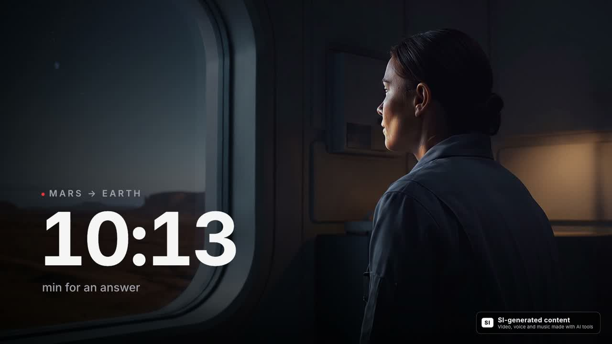
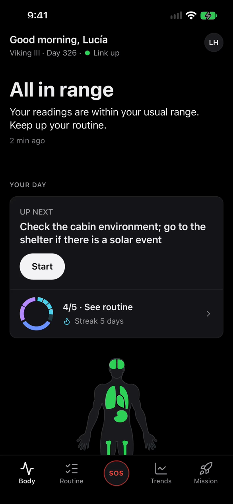
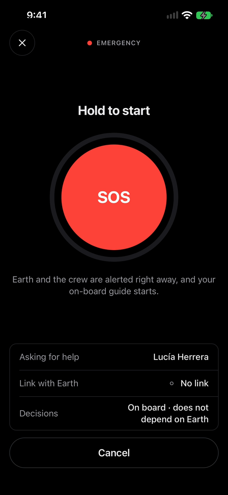
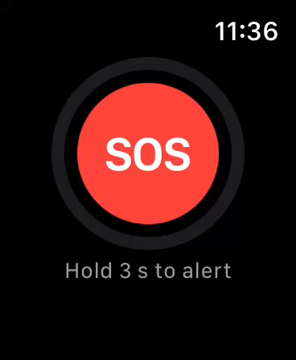
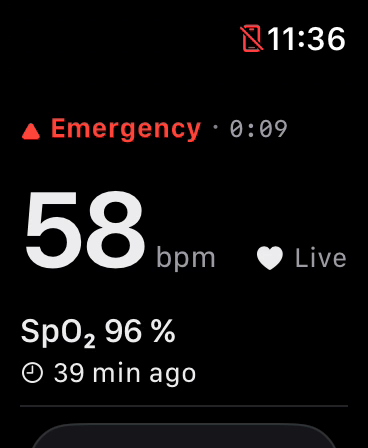
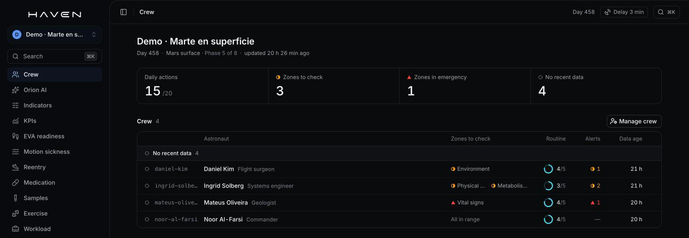

# HAVEN by CODA

**Health monitoring for astronauts on long-duration space missions.** NASA Space Apps Challenge 2026, challenge "Create Health Monitoring Software for Astronauts on Space Missions".

Astronauts use HAVEN on their iPhone and Apple Watch, and the ground team follows the crew from the web. When the link with Earth is down, HAVEN keeps assessing health on board, guides the crew through emergencies, and sends everything once the link returns.

**[Live demo](https://haven-eta-gray.vercel.app)** · **[Pitch video](https://drive.google.com/file/d/1Xk2zhs-Yg1U44h9WM2Ouykg358VOCM6G/view)** · [Versión en español](README.es.md)

[](https://drive.google.com/file/d/1Xk2zhs-Yg1U44h9WM2Ouykg358VOCM6G/view)

> HAVEN is a decision-support tool. It is not a medical device and is not affiliated with NASA.

## Screenshots

| Astronaut app | SOS triage | Apple Watch SOS | Watch emergency |
|:---:|:---:|:---:|:---:|
|  |  |  |  |

**Ground View (web)**



## How it works

| Component | What it does | Code |
|---|---|---|
| Astronaut app | Health indicators, daily routine, cognitive tests, SOS and an offline send queue | `apps/mobile` (Expo) |
| Apple Watch | Live heart rate and SOS alarm | `apps/mobile/targets/watch` (SwiftUI) |
| Ground View | Missions, crew status, KPIs and the Orion AI assistant | `apps/web` (Next.js, MongoDB) |
| Core | Shared rules engine and versioned health thresholds | `packages/core` |

## Run it

```bash
pnpm install
cp apps/web/.env.example apps/web/.env.local   # set MONGODB_URI
pnpm dev:web                                   # http://localhost:3000
pnpm --filter web seed                         # sample mission (code ARES01)
cd apps/mobile && pnpm ios                     # iPhone + Apple Watch simulator
```

Requires Node 24, pnpm 12 and MongoDB. iOS builds need macOS with Xcode.

## AI disclosure

The idea and the design of HAVEN are our team's own. We used AI tools only to speed up the work:

- **Code:** we used **Claude Code (Anthropic)** as a coding assistant to write, refactor, debug, test and document parts of this repository. The team reviewed and tested all of that code. Commits made with AI help carry a `Co-Authored-By: Claude` line.
- **Documentation:** Gemini (NotebookLM) helped us manage sources, and ChatGPT helped us check the technical document against the code and edit it.
- **Video:** the CGI clips were made with Higgsfield (Google Veo 3.1), and the voice, music and sound effects with ElevenLabs. The AI-generated visuals have a visible watermark, and the video file states it in its metadata.
- **In the product:** the Orion AI assistant uses the OpenAI API.

No NASA logos or mission identifiers were generated with AI.

## License

Apache 2.0. See [LICENSE](LICENSE).
